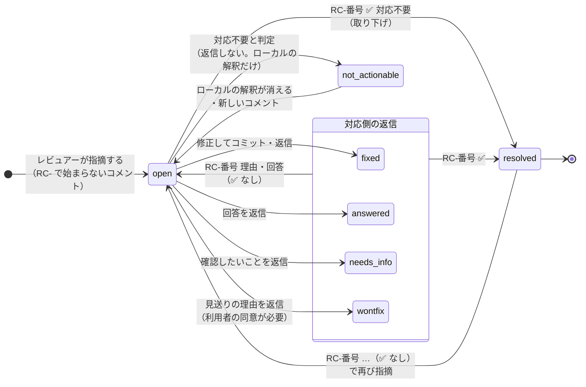

# 指摘の状態の移り変わり

指摘（レビューコメントのスレッド）1 件ごとの状態と、状態を変える操作をまとめた図。決まりの正は [plan.md](plan.md) の §4-4（状態の移り変わり）・§4-2（レビュアーの書き方）・§7-16（決着の表示）。実装は `src/thread/thread.ts` の `buildThreads`。

## 状態の一覧

| 状態 | 意味 | 次に動く人 | サマリーの表示 |
|---|---|---|---|
| `open` | 未対応（新しい指摘、または再指摘・回答を受けた） | 対応側（自動対応） | ⏳ open |
| `fixed` | 修正して返信した | レビュアー | ✅ fixed |
| `answered` | 質問に回答した | レビュアー | :speech_balloon: answered |
| `needs_info` | 確認したいことがある（直し方が決まらない・見送ってよいかを聞く） | レビュアー | ❓ needs_info |
| `wontfix` | 理由を添えて見送った（利用者が見送りに同意したときだけ） | レビュアー | :no_good: wontfix |
| `resolved` | 完了 | なし | ☑️ resolved（決着） |
| `not_actionable` | 対応のいらないコメント（「LGTM」など）。返信しない | なし | 表に出さない |

## 図

## 状態の決め方（実装の規則）

状態は保存しておくのではなく、毎回 Backlog のコメントから決め直す。スレッドのコメントを古い順に見て、**最後のコメント**で決まる。

| 最後のコメント | 状態 |
|---|---|
| 指摘だけ（返信なし） | `open` |
| 対応側の自動返信（`[review-bot … status=X]`） | そのマーカーの `X`（`fixed` / `answered` / `needs_info` / `wontfix`） |
| レビュアーの `RC-番号 ✅`（`✅ 対応不要` も） | `resolved` |
| レビュアーの `RC-番号 …`（✅ なし） | `open` |

- この規則は**どの状態からでも**同じように働く。たとえば `resolved` の指摘にも `RC-番号 理由` と書けば `open` に戻り、`open` の指摘に `RC-番号 ✅` と書けば（返信を待たずに）`resolved` になる
- `not_actionable` だけは Backlog に返信が残らないので、対応側のローカルの解釈（`.review-state/`）から求める。状態が `open` で、解釈が「返信しない」で、その後に新しいコメントがないときだけ `not_actionable` になる。ローカルの状態が消えると `open` に戻り、解釈し直しになる（レビュー側からは `open` に見える）
- 自動返信の後に元の指摘が編集されても、状態は変えない。警告を出して人間に確かめてもらう

## 完了したときの決着（§7-16）

`resolved` は「完了」の意味だけを持つ。どう決着したかは、別の項目としてサマリーの括弧と記録の「対応区分」に出す。状態は増やさない。

| 決着 | 決め方 | サマリー | 記録の対応区分 |
|---|---|---|---|
| 取り下げ | 解決のコメントが `RC-番号 ✅ 対応不要` | ☑️ resolved（取り下げ） | 取り下げ |
| 修正 | 最後の自動返信が `fixed` | ☑️ resolved（修正） | 修正 |
| 回答 | 最後の自動返信が `answered` | ☑️ resolved（回答） | 回答 |
| 見送り | 最後の自動返信が `wontfix` | ☑️ resolved（見送り） | 見送り |
| （なし） | 最後の自動返信が `needs_info`、または返信がない | ☑️ resolved | 確認中 / 空 |

取り下げの判定は、ほかの決め方より先に行う（返信の後に取り下げても「取り下げ」になる）。

## 進み具合の数え方（§4-5）

`not_actionable` を除いて数える。

- 完了: `resolved`
- レビュアーの確認待ち: `fixed`・`answered`・`needs_info`・`wontfix`
- 自動対応待ち: `open`
